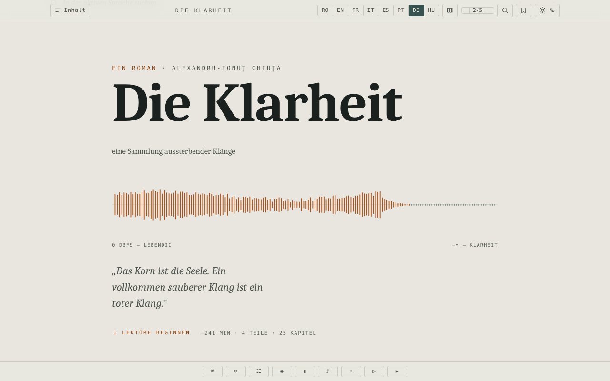

# Limpezimea

[English](README.md) · [Română](README.ro.md) · [Français](README.fr.md) · [Italiano](README.it.md) · [Español](README.es.md) · [Português](README.pt.md) · **Deutsch** · [Magyar](README.hu.md)

**Version:** 1.2.4 · **Zuletzt aktualisiert:** 2026-10-22

Oberflächensprachen: **Română, English, Français, Italiano, Español, Português (PT), Deutsch, Magyar**

Science-Fiction-Roman von Alexandru-Ionuț Chiuță, Leseausgabe in einer einzigen HTML-Datei, in acht Sprachen (RO · EN · FR · IT · ES · PT · DE · HU).

**Online-App:** https://chiuta.github.io/Limpezimea/

## Was es ist

*Limpezimea* ist ein Science-Fiction-Roman (die Beschreibung auf der Seite: ein Bergsee („tău“) im Retezat-Gebirge, der Klang, Ordnung und Erinnerung frisst). Die Datei `index.html` enthält den vollständigen Text auf Rumänisch und Übersetzungen ins Englische, Französische, Italienische, Spanische, Portugiesische, Deutsche und Ungarische sowie einen kritischen Apparat (Chronik, „Tăul Mut“, Studie). Laut dem Hinweis im Kolophon wurde der kritische Apparat mit KI-Unterstützung (Claude) verfasst. Die App weist 43.359 Wörter aus, etwa 241 Minuten Lesezeit.

## Funktionen

- Umschalten zwischen den 8 Sprachen (Schaltflächen RO / EN / FR / IT / ES / PT / DE / HU; der Roman, die Chronik, „Tăul Mut“ und die kritische Studie liegen in allen 8 Sprachen vor); Option zur parallelen Anzeige mehrerer Sprachen (Schaltfläche „Anzahl der Sprachen“).
- Inhaltsverzeichnis nach Teilen und Kapiteln, Navigation mit Pfeiltasten, Befehlspalette.
- Designs: dunkel, hell, Sepia, „See“; Textgröße in 5 Stufen (A− / A+).
- Volltextsuche (Trefferliste mit Kontext, Sprung zum Vorkommen; erscheint der Begriff in der aktiven Sprache nicht, gibt es Schaltflächen zum Wechsel in die Sprachen, in denen er vorkommt), Konkordanz, Glossar der „Unübersetzbaren“, Minimap, Fokusmodus.
- Lesezeichen und persönliche Notizen (mit Export der Marginalien).
- Ausschneidbares Zitat, „Korn“-Textur über dem Text, generative Klanglandschaft (Web Audio), automatisches Scrollen, „Hören“ (Sprachsynthese des Browsers).
- Spoilerschutz vor dem kritischen Apparat („Gate“), mit gemerkter Freischaltung.
- Unterstützung der Barrierefreiheit: Link „Zum Text springen“, ARIA-Live-Region, Beachtung der Einstellung für reduzierte Bewegung.

## Bedienungsanleitung

1. Öffne die Seite; wähle die Sprache mit den Schaltflächen RO … HU (die Tasten `1`–`8` wählen die Sprache; `Shift` oder `Ctrl`/`Cmd` + Klick oder langes Drücken schaltet die Parallelanzeige um).
2. Öffne „Inhalt“, um zu einem Kapitel zu springen. `←` / `→` oder `k` / `j` wechseln zum vorherigen/nächsten Kapitel; `Home`, `End`, `PageUp`, `PageDown` scrollen.
3. `/` öffnet die Suche; `Ctrl+K` / `Cmd+K` öffnet die Befehlspalette; `Esc` schließt die Felder.
4. `B` setzt/entfernt ein Lesezeichen an der aktuellen Position; `N` fügt eine Notiz hinzu; `F` startet den Fokusmodus; `P` ändert die Anzahl der angezeigten Sprachen.
5. Die Design-Schaltfläche schaltet zyklisch durch die Designs; A− / A+ ändern die Textgröße (ein Klick auf „2/5“ setzt sie zurück).
6. Die Schaltflächen in der unteren Leiste: Befehle, Unübersetzbares (Glossar), Konkordanz, Fokusmodus, Minimap, Klangfeld, Korn, Wiedergabe (automatisches Scrollen), Hören.
7. Leseposition, Lesezeichen und Notizen werden automatisch im Browser gespeichert.

## Datenschutz und Netzwerk

- Die App führt keine Netzwerkaufrufe aus (kein `fetch`, keine CDNs oder externen Ressourcen); das Kolophon versichert „kein Tracking, keine Konten“.
- **Lokaler Speicher (`localStorage`, Schlüssel mit dem Präfix `limp.`):** Sprache, Design, Textgröße, Leseposition, Lesezeichen, Notizen, Einstellungen (Fokus, Minimap, Korn, Klanglautstärke, Scrollgeschwindigkeit), Freischaltstatus des kritischen Apparats.
- „Hören“ nutzt die Sprachsynthese des Browsers/Systems; das Verhalten hängt davon ab.

## Lokale / Offline-Ausführung

Lade `index.html` herunter (etwa 2,6 MB) und öffne die Datei im Browser; es ist kein Internet nötig.

## Lizenz

MIT — siehe Datei LICENSE

## Audit

2026-10-10: im Browser geprüft (0 JS-Fehler, 0 Netzwerkanfragen; Speicher nur `limp.*` in localStorage). Kontrast der gesperrten Einträge im Inhaltsverzeichnis korrigiert. Der literarische Text und die Übersetzungen (auch die KI-gestützten) wurden bei diesem Audit nicht redaktionell überprüft. (Die CSP-Richtlinie wurde am 2026-10-11 hinzugefügt, siehe Verlauf.)

## Verlauf / Changelog

- 1.2.2 — 2026-10-19: Die ungarische Ausgabe ist vollständig: Der Roman (25 Kapitel), die Chronik (38 Einträge), die Erzählung „Tăul Mut“ (22) und die kritische Studie (31) sind ins Ungarische übersetzt, sodass der gesamte Inhalt in allen 8 Sprachen vorliegt (zuvor zeigte Ungarisch den englischen Text). Der ungarische Text wurde mit KI-Unterstützung und ohne ungarische Rechtschreibprüfung verfasst und **muss von einem Muttersprachler Korrektur gelesen werden**; die Figurennamen folgen der englischen Ausgabe (Ellie, Andrew, Serena, Theodore, Matthew, Mary, Roland, Anna). Die Datei ist jetzt etwa 3 MB groß.
- 1.2.1 — 2026-10-19: Die Schaltflächen für die Textgröße (A− / A+) in der Werkzeugleiste waren leer, und ihre zugänglichen Beschriftungen gab es nur auf RO/EN; sie zeigen jetzt A− und A+ und haben Beschriftungen in 8 Sprachen.

- 1.1.0 — 2026-10-14: Datensicherung und Datenkennzeichnung (fff-kit).

- 1.0.0 — 2026-10-12: Version und Datum der letzten Aktualisierung werden in der App angezeigt (erste nummerierte Version; im Kolophon in der Fußzeile, beschriftet in den 7 Sprachen).

Runde 7:
- **Behoben (vorher reproduziert, nachher überprüft):** Man wählte eine Sprache (z. B. EN), drückte die Schaltfläche „Angezeigte Sprachen“, um eine zweite Sprache hinzuzufügen, und die Oberfläche (Statusmeldungen wie „Lesezeichen hinzugefügt“, `lang` auf `<html>`, Suche in der aktiven Sprache) wechselte ins Rumänische, weil RO in der Spaltenreihenfolge immer an erster Stelle steht. Die vom Leser gewählte Sprache bleibt nun auch im Vergleichsmodus die Hauptsprache (die Spaltenreihenfolge hat sich nicht geändert) und wird beim Neuladen beibehalten. CSP-Hashes neu berechnet; axe-core = 0 Verstöße bei 1280 und 360 px.
- Der literarische Text und die Übersetzungen wurden nicht verändert; die Dateigröße (~2,6 MB) ergibt sich aus dem Text in sieben Sprachen, nicht aus eingebetteten Ressourcen, und kann daher nicht ohne Inhaltsverlust verringert werden.

Runde 6:
- Suche: Trefferliste mit Kontext (die ersten 100, Klick = Sprung zum Vorkommen) und, bei 0 Treffern in der aktiven Sprache, Schaltflächen, die direkt in die Sprache wechseln, in der der Begriff vorkommt; das Scrollen berücksichtigt die Höhe des Feldes. CSP-Hashes neu berechnet.
- Textsuche: Wenn es in der aktiven Sprache keine Treffer gibt, zeigt die Leiste nun an, in welchen anderen Sprachen der Begriff vorkommt (z. B. „0 · RO: 70, DE: 30“ für „tău“ im Französischen), statt eines schlichten „0“.
- Barrierefreiheit: Das Cover, die Fortschrittsleiste und die Werkzeugleiste befinden sich nun in ARIA-Landmarks; axe-core = 0 Verstöße (einschließlich `region`) bei 1280 und 360 px.
- CSP-Richtlinie hinzugefügt (`<meta>`: Skripte nur per Hash, `connect-src 'none'`).
- Der literarische Text und die Übersetzungen wurden nicht verändert.

## Autor

Alexio — Alexandru-Ionuț Chiuță. Kontakt: alexio@trom.tf

## Zusammenfassung
Limpezimea („Klarheit“) ist ein Science-Fiction-Roman von Alexandru-Ionuț Chiuță, als Offline-Leseausgabe in einer einzigen HTML-Datei in acht Sprachen (RO, EN, FR, IT, ES, PT, DE, HU) verpackt, mit einem kritischen Apparat, der teilweise mit KI-Unterstützung (Claude) verfasst wurde. Funktionen: parallele Sprachen, Designs, Suche, Lesezeichen und Notizen, Klanglandschaft, Fokusmodus. Keine Netzwerkanfragen; Einstellungen werden in localStorage (`limp.*`) gespeichert. MIT-Lizenz.

### 1.2.4 — 2026-10-22
- Die noch englischen oder zweisprachigen Beschriftungen (Fortschritt, Zurücksetzen, Thema, Inhalt, Umschlag, Zugang zum kritischen Apparat, Werkzeuge) sind jetzt in allen 8 Sprachen übersetzt und folgen dem Sprachwechsel.

### 1.2.3 — 2026-10-22
- Die Barrierefreiheits-Beschriftungen (Lesefortschritt, Pause, Schließen-Schaltflächen) und der Befehl „Auf Rumänisch lesen“ sind in alle Sprachen übersetzt.

