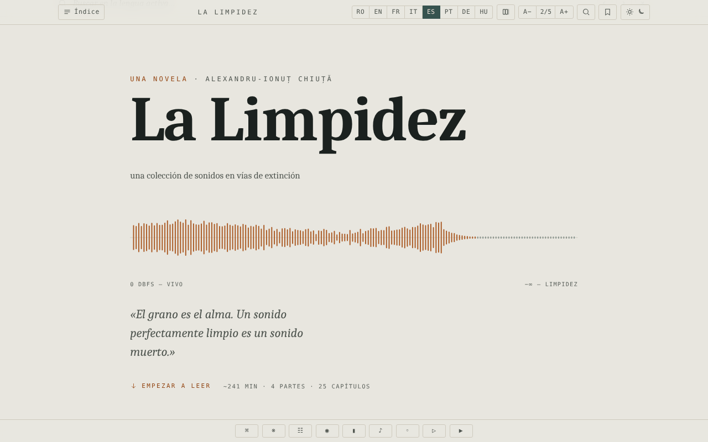

# Limpezimea

[English](README.md) · [Română](README.ro.md) · [Français](README.fr.md) · [Italiano](README.it.md) · **Español** · [Português](README.pt.md) · [Deutsch](README.de.md) · [Magyar](README.hu.md)

**Versión:** 1.2.5 · **Última actualización:** 2026-10-22

Idiomas de la interfaz: **Română, English, Français, Italiano, Español, Português (PT), Deutsch, Magyar**

Novela de ciencia ficción de Alexandru-Ionuț Chiuță, edición de lectura en un único archivo HTML, en ocho idiomas (RO · EN · FR · IT · ES · PT · DE · HU).

**Aplicación en línea:** https://chiuta.github.io/Limpezimea/

## Qué es

*Limpezimea* es una novela de ciencia ficción (la descripción de la página: un lago glaciar («tău») de los montes Retezat que devora el sonido, el orden y el recuerdo). El archivo `index.html` contiene el texto completo en rumano y traducciones al inglés, francés, italiano, español, portugués, alemán y húngaro, además de un aparato crítico (crónica, «Tăul Mut», estudio). Según la nota del colofón, el aparato crítico fue escrito con ayuda de IA (Claude). La aplicación indica 43.359 palabras, unos 241 minutos de lectura.

## Funciones

- Cambio entre los 8 idiomas (botones RO / EN / FR / IT / ES / PT / DE / HU; la novela, la crónica, «Tăul Mut» y el estudio crítico existen en los 8 idiomas); opción para mostrar varios idiomas en paralelo (botón «Número de idiomas»).
- Índice por partes y capítulos, navegación con flechas, paleta de comandos.
- Temas: oscuro, claro, sepia, «lago»; tamaño del texto en 5 niveles (A− / A+).
- Búsqueda en el texto (lista de resultados con contexto, salto a la aparición; si el término no aparece en el idioma activo, botones para cambiar a los idiomas donde sí aparece), concordancia, glosario de «intraducibles», minimapa, modo enfoque.
- Marcadores y notas personales (con exportación de las glosas marginales).
- Cita recortable, textura de «grano» sobre el texto, paisaje sonoro generativo (Web Audio), desplazamiento automático, «Escuchar» (síntesis de voz del navegador).
- Puerta antispoiler ante el aparato crítico («gate»), con desbloqueo memorizado.
- Soporte de accesibilidad: enlace «Saltar al texto», región ARIA live, respeto de la preferencia de movimiento reducido.

## Manual de uso

1. Abra la página; elija el idioma con los botones RO … HU (las teclas `1`–`8` eligen el idioma; `Shift` o `Ctrl`/`Cmd` + clic, o una pulsación larga, alterna la visualización en paralelo).
2. Abra «Índice» para saltar a un capítulo. `←` / `→` o `k` / `j` pasan al capítulo anterior/siguiente; `Home`, `End`, `PageUp`, `PageDown` desplazan el texto.
3. `/` abre la búsqueda; `Ctrl+K` / `Cmd+K` abre la paleta de comandos; `Esc` cierra los paneles.
4. `B` añade/quita un marcador en la posición actual; `N` añade una nota; `F` activa el modo enfoque; `P` cambia el número de idiomas mostrados.
5. El botón de tema recorre los temas cíclicamente; A− / A+ cambian el tamaño del texto (un clic en «2/5» lo restablece).
6. Los botones de la barra inferior: Comandos, Intraducibles (glosario), Concordancia, Modo enfoque, Minimapa, Campo sonoro, Grano, Reproducir (desplazamiento automático), Escuchar.
7. La posición de lectura, los marcadores y las notas se conservan automáticamente en el navegador.

## Privacidad y red

- La aplicación no realiza llamadas de red (sin `fetch`, CDN ni recursos externos); el colofón afirma «sin seguimiento, sin cuentas».
- **Almacenamiento local (`localStorage`, claves con el prefijo `limp.`):** idioma, tema, tamaño del texto, posición de lectura, marcadores, notas, preferencias (enfoque, minimapa, grano, volumen del sonido, velocidad de desplazamiento), estado de desbloqueo del aparato crítico.
- «Escuchar» usa la síntesis de voz del navegador/del sistema; el comportamiento depende de estos.

## Ejecución local / sin conexión

Descargue `index.html` (unos 2,6 MB) y ábralo en el navegador; no requiere internet.

## Licencia

MIT — véase el archivo LICENSE

## Auditoría

2026-10-10: verificado en el navegador (0 errores de JS, 0 solicitudes de red; almacenamiento solo `limp.*` en localStorage). Corregido el contraste de las entradas bloqueadas del índice. El texto literario y las traducciones (incluidas las asistidas por IA) no se revisaron editorialmente en esta auditoría. (La política CSP se añadió el 2026-10-11, véase Historial.)

## Historial / Changelog

- 1.2.2 — 2026-10-19: la edición húngara está completa: la novela (25 capítulos), la crónica (38 elementos), el relato «Tăul Mut» (22) y el estudio crítico (31) están traducidos al húngaro, por lo que todo el contenido existe en los 8 idiomas (antes, en húngaro se mostraba el texto inglés). El texto húngaro se escribió con ayuda de IA, sin corrector ortográfico húngaro, y **necesita la corrección de un hablante nativo**; los nombres de los personajes siguen la edición inglesa (Ellie, Andrew, Serena, Theodore, Matthew, Mary, Roland, Anna). El archivo pesa ahora unos 3 MB.
- 1.2.1 — 2026-10-19: los botones de tamaño del texto (A− / A+) de la barra de herramientas estaban vacíos y sus etiquetas accesibles solo existían en RO/EN; ahora muestran A− y A+ y tienen etiquetas en 8 idiomas.

- 1.1.0 — 2026-10-14: Copia de seguridad y etiquetado de datos (fff-kit).

- 1.0.0 — 2026-10-12: la versión y la fecha de la última actualización se muestran en la aplicación (primera versión numerada; en el colofón del pie de página, con etiqueta en los 7 idiomas).

Ronda 7:
- **Corregido (reproducido antes, verificado después):** se elegía un idioma (p. ej. EN), se pulsaba el botón «Idiomas mostrados» para añadir un segundo idioma, y la interfaz (mensajes de estado como «Marcador añadido», `lang` en `<html>`, búsqueda en el idioma activo) pasaba al rumano, porque RO siempre es el primero en el orden de las columnas. El idioma elegido por el lector sigue ahora siendo el principal también en el modo comparativo (el orden de las columnas no ha cambiado) y se conserva al recargar. Hashes CSP recalculados; axe-core = 0 infracciones a 1280 y 360 px.
- El texto literario y las traducciones no se han modificado; el tamaño del archivo (~2,6 MB) se debe al texto en siete idiomas, no a recursos incrustados, por lo que no se puede reducir sin perder contenido.

Ronda 6:
- Búsqueda: lista de resultados con contexto (los primeros 100, clic = salto a la aparición) y, con 0 resultados en el idioma activo, botones que cambian directamente al idioma donde aparece el término; el desplazamiento tiene en cuenta la altura del panel. Hashes CSP recalculados.
- Búsqueda en el texto: cuando no hay resultados en el idioma activo, la barra muestra ahora en qué otros idiomas aparece el término (p. ej. «0 · RO: 70, DE: 30» para «tău» en francés), en lugar de un simple «0».
- Accesibilidad: la portada, la barra de progreso y la barra de herramientas están ahora en puntos de referencia ARIA; axe-core = 0 infracciones (incluida `region`) a 1280 y 360 px.
- Añadida una política CSP (`<meta>`: scripts solo por hash, `connect-src 'none'`).
- El texto literario y las traducciones no se han modificado.

## Autor

Alexio — Alexandru-Ionuț Chiuță. Contacto: alexio@trom.tf

## Resumen

Limpezimea («Limpidez») es una novela de ciencia ficción de Alexandru-Ionuț Chiuță, empaquetada como una edición de lectura sin conexión en un único archivo HTML, en ocho idiomas (RO, EN, FR, IT, ES, PT, DE, HU), con un aparato crítico escrito en parte con ayuda de IA (Claude). Funciones: idiomas en paralelo, temas, búsqueda, marcadores y notas, paisaje sonoro, modo enfoque. Sin solicitudes de red; preferencias guardadas en localStorage (`limp.*`). Licencia MIT.

### 1.2.5 — 2026-10-22
- Móvil: todos los subtítulos y botones de la interfaz que estaban por debajo de 12 px (unas 45 reglas: barra de herramientas, índice, duraciones de capítulos, botones de idioma, notas, notificación) pasan a un mínimo de 12 px; el enlace «empezar a leer» tiene un área táctil mayor. Los controles de tamaño de texto (A−/A+) ya existían.

### 1.2.4 — 2026-10-22
- Las etiquetas que seguían en inglés o bilingües (progreso, restablecer, tema, índice, portada, acceso al aparato crítico, herramientas) ya están traducidas a los 8 idiomas y se actualizan al cambiar de idioma.

### 1.2.3 — 2026-10-22
- Las etiquetas de accesibilidad (progreso de lectura, pausa, botones de cierre) y el comando «Leer en rumano» están traducidos a todos los idiomas.

