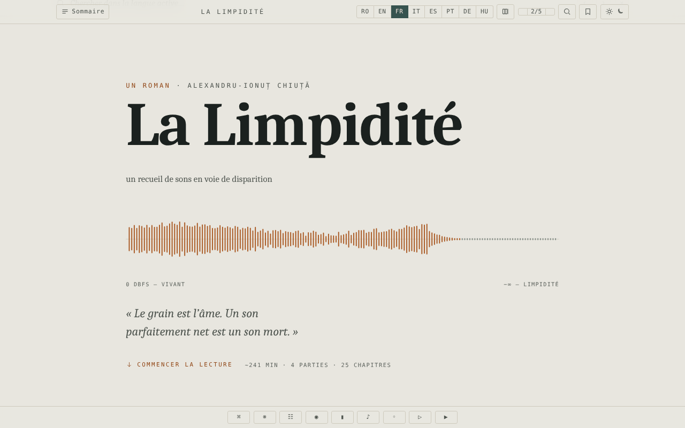

# Limpezimea

[English](README.md) · [Română](README.ro.md) · **Français** · [Italiano](README.it.md) · [Español](README.es.md) · [Português](README.pt.md) · [Deutsch](README.de.md) · [Magyar](README.hu.md)

**Version :** 1.2.9 · **Dernière mise à jour :** 2026-10-23

Langues de l'interface : **Română, English, Français, Italiano, Español, Português (PT), Deutsch, Magyar**

Roman de science-fiction d'Alexandru-Ionuț Chiuță, édition de lecture en un seul fichier HTML, en huit langues (RO · EN · FR · IT · ES · PT · DE · HU).

**Application en ligne :** https://chiuta.github.io/Limpezimea/

## Ce que c'est

*Limpezimea* est un roman de science-fiction (la description de la page : un lac glaciaire (« tău ») des monts Retezat qui dévore le son, l'ordre et le souvenir). Le fichier `index.html` contient le texte intégral en roumain et des traductions en anglais, français, italien, espagnol, portugais, allemand et hongrois, ainsi qu'un appareil critique (chronique, « Tăul Mut », étude). Selon la note du colophon, l'appareil critique a été rédigé avec l'aide de l'IA (Claude). L'application indique 43 359 mots, environ 241 minutes de lecture.

## Fonctionnalités

- Bascule entre les 8 langues (boutons RO / EN / FR / IT / ES / PT / DE / HU ; le roman, la chronique, « Tăul Mut » et l'étude critique existent dans les 8 langues) ; option d'affichage de plusieurs langues en parallèle (bouton « Nombre de langues »).
- Table des matières par parties et chapitres, navigation aux flèches, palette de commandes.
- Thèmes : sombre, clair, sépia, « tarn » ; taille du texte en 5 paliers (A− / A+).
- Recherche dans le texte (liste de résultats avec contexte, saut à l'occurrence ; si le terme n'apparaît pas dans la langue active, boutons de bascule vers les langues où il apparaît), concordance, glossaire des « intraduisibles », minicarte, mode focus.
- Signets et notes personnelles (avec export des marginalia).
- Citation découpable, texture de « grain » sur le texte, paysage sonore génératif (Web Audio), défilement automatique, « Écouter » (synthèse vocale du navigateur).
- Porte anti-spoiler devant l'appareil critique (« gate »), avec déverrouillage mémorisé.
- Prise en charge de l'accessibilité : lien « Aller au texte », région ARIA live, respect de la préférence pour la réduction des animations.

## Mode d'emploi

1. Ouvrez la page ; choisissez la langue avec les boutons RO … HU (les touches `1`–`8` choisissent la langue ; `Shift` ou `Ctrl`/`Cmd` + clic, ou appui long, bascule l'affichage parallèle).
2. Ouvrez « Sommaire » pour sauter à un chapitre. `←` / `→` ou `k` / `j` passent au chapitre précédent/suivant ; `Home`, `End`, `PageUp`, `PageDown` font défiler.
3. `/` ouvre la recherche ; `Ctrl+K` / `Cmd+K` ouvre la palette de commandes ; `Esc` ferme les panneaux.
4. `B` ajoute/retire un signet à la position courante ; `N` ajoute une note ; `F` lance le mode focus ; `P` change le nombre de langues affichées.
5. Le bouton de thème parcourt les thèmes en boucle ; A− / A+ changent la taille du texte (un clic sur « 2/5 » la réinitialise).
6. Les boutons de la barre du bas : Commandes, Intraduisibles (glossaire), Concordance, Mode focus, Minicarte, Champ sonore, Grain, Lecture (défilement automatique), Écouter.
7. La position de lecture, les signets et les notes sont conservés automatiquement dans le navigateur.

## Confidentialité et réseau

- L'application n'effectue aucun appel réseau (ni `fetch`, ni CDN, ni ressources externes) ; le colophon affirme « pas de pistage, pas de comptes ».
- **Stockage local (`localStorage`, clés avec le préfixe `limp.`) :** langue, thème, taille du texte, position de lecture, signets, notes, préférences (focus, minicarte, grain, volume du son, vitesse de défilement), état de déverrouillage de l'appareil critique.
- « Écouter » utilise la synthèse vocale du navigateur/du système ; le comportement en dépend.

## Exécution locale / hors ligne

Téléchargez `index.html` (environ 2,6 Mo) et ouvrez-le dans le navigateur ; aucune connexion internet n'est nécessaire.

## Licence

MIT — voir le fichier LICENSE

## Audit

2026-10-10 : vérifié dans le navigateur (0 erreur JS, 0 requête réseau ; stockage uniquement `limp.*` dans localStorage). Contraste des entrées verrouillées de la table des matières corrigé. Le texte littéraire et les traductions (y compris celles assistées par l'IA) n'ont pas fait l'objet d'une révision éditoriale lors de cet audit. (La politique CSP a été ajoutée le 2026-10-11, voir Historique.)

## Historique / Changelog

### 1.2.9 — 2026-10-23

- Stockage : les clés portent désormais le préfixe de l'application (`limpezimea.*`) ; les données existantes sont migrées automatiquement au démarrage depuis les anciennes clés (`limp.*`), et les anciennes sauvegardes `.fff.json` s'importent toujours (fff-kit 1.2.0).
- Dialogues : les boîtes natives `alert`/`confirm`/`prompt` ont été remplacées par des dialogues `FFF.dialog` accessibles et traduits (clavier, piège de focus, Échap), au comportement identique (fff-kit 1.2.0).

### 1.2.7 — 2026-10-22

fff-kit 1.1.4 : cibles tactiles et taille de texte minimale. Cibles tactiles/texte corrigés dans l’application.

### 1.2.6 — 2026-10-22

fff-kit 1.1.2 : PBKDF2 600 000 itérations, protection anti-clickjacking.

- 1.2.2 — 2026-10-19 : l'édition hongroise est complète : le roman (25 chapitres), la chronique (38 éléments), la nouvelle « Tăul Mut » (22) et l'étude critique (31) sont traduits en hongrois, de sorte que tout le contenu existe dans les 8 langues (auparavant, le hongrois affichait le texte anglais). Le texte hongrois a été rédigé avec l'aide de l'IA, sans correcteur orthographique hongrois, et **doit être relu par un locuteur natif** ; les noms des personnages suivent l'édition anglaise (Ellie, Andrew, Serena, Theodore, Matthew, Mary, Roland, Anna). Le fichier fait désormais environ 3 Mo.
- 1.2.1 — 2026-10-19 : les boutons de taille du texte (A− / A+) de la barre d'outils étaient vides et leurs étiquettes accessibles n'existaient qu'en RO/EN ; ils affichent maintenant A− et A+ et ont des étiquettes en 8 langues.

- 1.1.0 — 2026-10-14 : Sauvegarde et étiquetage des données (fff-kit).

- 1.0.0 — 2026-10-12 : la version et la date de la dernière mise à jour sont affichées dans l'application (première version numérotée ; dans le colophon du pied de page, avec une étiquette dans les 7 langues).

Tour 7 :
- **Corrigé (reproduit avant, vérifié après) :** on choisissait une langue (p. ex. EN), on appuyait sur le bouton « Langues affichées » pour ajouter une deuxième langue, et l'interface (messages d'état comme « Signet ajouté », `lang` sur `<html>`, recherche dans la langue active) passait en roumain, car RO est toujours première dans l'ordre des colonnes. La langue choisie par le lecteur reste désormais la langue principale aussi en mode comparatif (l'ordre des colonnes n'a pas changé) et est conservée au rechargement. Hachages CSP recalculés ; axe-core = 0 violation à 1280 et 360 px.
- Le texte littéraire et les traductions n'ont pas été modifiés ; la taille du fichier (~2,6 Mo) tient au texte en sept langues, et non à des ressources intégrées ; elle ne peut donc pas être réduite sans perte de contenu.

Tour 6 :
- Recherche : liste de résultats avec contexte (les 100 premiers, clic = saut à l'occurrence) et, à 0 résultat dans la langue active, boutons qui basculent directement vers la langue où le terme apparaît ; le défilement tient compte de la hauteur du panneau. Hachages CSP recalculés.
- Recherche dans le texte : quand il n'y a aucun résultat dans la langue active, la barre indique désormais dans quelles autres langues le terme apparaît (p. ex. « 0 · RO: 70, DE: 30 » pour « tău » en français), au lieu d'un simple « 0 ».
- Accessibilité : la couverture, la barre de progression et la barre d'outils sont désormais dans des repères ARIA ; axe-core = 0 violation (y compris `region`) à 1280 et 360 px.
- Ajout d'une politique CSP (`<meta>` : scripts uniquement par hachage, `connect-src 'none'`).
- Le texte littéraire et les traductions n'ont pas été modifiés.

## Auteur

Alexio — Alexandru-Ionuț Chiuță. Contact : alexio@trom.tf

## Résumé
Limpezimea (« Limpidité ») est un roman de science-fiction d'Alexandru-Ionuț Chiuță, présenté comme une édition de lecture hors ligne en un seul fichier HTML, en huit langues (RO, EN, FR, IT, ES, PT, DE, HU), avec un appareil critique en partie rédigé avec l'aide de l'IA (Claude). Fonctionnalités : langues en parallèle, thèmes, recherche, signets et notes, paysage sonore, mode focus. Aucune requête réseau ; préférences stockées dans localStorage (`limp.*`). Licence MIT.

### 1.2.5 — 2026-10-22
- Mobile : toutes les légendes et tous les boutons de l'interface qui étaient sous 12 px (environ 45 règles : barre d'outils, sommaire, durées des chapitres, boutons de langue, notes, notification) font maintenant au moins 12 px ; le lien « commencer la lecture » a une zone tactile plus grande. Les commandes de taille du texte (A−/A+) existaient déjà.

### 1.2.4 — 2026-10-22
- Les libellés restés en anglais ou bilingues (progression, réinitialisation, thème, sommaire, couverture, accès à l’appareil critique, outils) sont désormais traduits dans les 8 langues et suivent la langue choisie.

### 1.2.3 — 2026-10-22
- Les étiquettes d'accessibilité (progression de lecture, pause, boutons de fermeture) et la commande « Lire en roumain » sont traduites dans toutes les langues.

