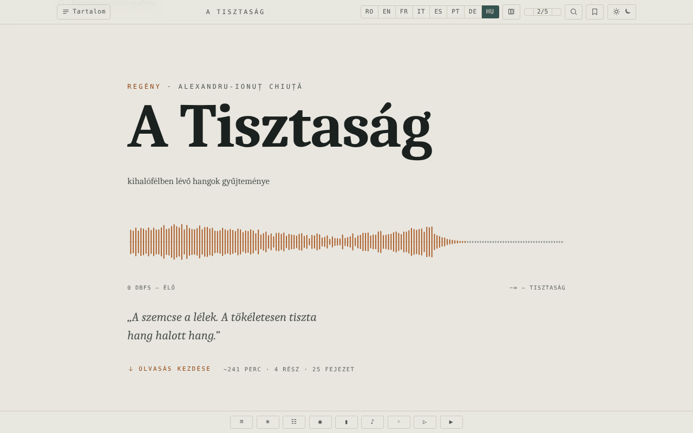

# Limpezimea

[English](README.md) · [Română](README.ro.md) · [Français](README.fr.md) · [Italiano](README.it.md) · [Español](README.es.md) · [Português](README.pt.md) · [Deutsch](README.de.md) · **Magyar**

**Verzió:** 1.2.5 · **Utolsó frissítés:** 2026-10-22

A felület nyelvei: **Română, English, Français, Italiano, Español, Português (PT), Deutsch, Magyar**

Alexandru-Ionuț Chiuță sci-fi regénye, olvasókiadás egyetlen HTML-fájlban, nyolc nyelven (RO · EN · FR · IT · ES · PT · DE · HU).

**Online alkalmazás:** https://chiuta.github.io/Limpezimea/

## Mi ez

A *Limpezimea* egy sci-fi regény (az oldalon szereplő leírás szerint: egy retyezáti hegyi tó („tău”), amely felfalja a hangot, a rendet és az emlékezetet). Az `index.html` fájl tartalmazza a teljes román szöveget, valamint angol, francia, olasz, spanyol, portugál, német és magyar fordításokat, továbbá egy kritikai apparátust (krónika, „Tăul Mut”, tanulmány). A kolofon megjegyzése szerint a kritikai apparátus MI-támogatással (Claude) készült. Az alkalmazás 43 359 szót jelez, nagyjából 241 perc olvasnivalót.

## Funkciók

- Váltás a 8 nyelv között (RO / EN / FR / IT / ES / PT / DE / HU gombok; a regény, a krónika, a „Tăul Mut” és a kritikai tanulmány mind a 8 nyelven olvasható); lehetőség több nyelv párhuzamos megjelenítésére („Nyelvek száma” gomb).
- Tartalomjegyzék részek és fejezetek szerint, nyilakkal való navigáció, parancspaletta.
- Témák: sötét, világos, szépia, „tó”; szövegméret 5 fokozatban (A− / A+).
- Keresés a szövegben (találati lista környezettel, ugrás az előfordulásra; ha a kifejezés nem szerepel az aktív nyelvben, gombok a váltáshoz azokra a nyelvekre, ahol megtalálható), konkordancia, a „lefordíthatatlanok” szószedete, minitérkép, fókusz mód.
- Könyvjelzők és személyes jegyzetek (a margójegyzetek exportálásával).
- Kivágható idézet, „szemcse” textúra a szövegen, generatív hangtáj (Web Audio), automatikus görgetés, „Meghallgatás” (a böngésző beszédszintézise).
- Spoilervédő kapu a kritikai apparátus előtt („gate”), megjegyzett feloldással.
- Akadálymentesítési támogatás: „Ugrás a szöveghez” hivatkozás, ARIA live régió, a csökkentett mozgásra vonatkozó beállítás tiszteletben tartása.

## Használati útmutató

1. Nyisd meg az oldalt; válaszd ki a nyelvet az RO … HU gombokkal (az `1`–`8` billentyűk választják a nyelvet; a `Shift` vagy `Ctrl`/`Cmd` + kattintás, illetve a hosszú nyomás kapcsolja a párhuzamos megjelenítést).
2. Nyisd meg a „Tartalomjegyzék”-et, hogy egy fejezetre ugorj. A `←` / `→` vagy a `k` / `j` az előző/következő fejezetre lép; a `Home`, `End`, `PageUp`, `PageDown` görget.
3. A `/` megnyitja a keresést; a `Ctrl+K` / `Cmd+K` megnyitja a parancspalettát; az `Esc` bezárja a paneleket.
4. A `B` felvesz/töröl egy könyvjelzőt az aktuális pozíción; az `N` jegyzetet ad hozzá; az `F` elindítja a fókusz módot; a `P` módosítja a megjelenített nyelvek számát.
5. A téma gomb körbeléptet a témákon; az A− / A+ módosítja a szövegméretet (a „2/5”-re kattintva visszaáll az alapértékre).
6. Az alsó sáv gombjai: Parancsok, Lefordíthatatlanok (szószedet), Konkordancia, Fókusz mód, Minitérkép, Hangtér, Szemcse, Lejátszás (automatikus görgetés), Meghallgatás.
7. Az olvasási pozíció, a könyvjelzők és a jegyzetek automatikusan megmaradnak a böngészőben.

## Adatvédelem és hálózat

- Az alkalmazás nem kezdeményez hálózati hívásokat (nincs `fetch`, CDN vagy külső erőforrás); a kolofon kijelenti: „nincs követés, nincsenek fiókok”.
- **Helyi tárolás (`localStorage`, `limp.` előtagú kulcsok):** nyelv, téma, szövegméret, olvasási pozíció, könyvjelzők, jegyzetek, beállítások (fókusz, minitérkép, szemcse, hangerő, görgetési sebesség), a kritikai apparátus feloldási állapota.
- A „Meghallgatás” a böngésző/rendszer beszédszintézisét használja; a működés ezektől függ.

## Helyi / offline futtatás

Töltsd le az `index.html` fájlt (kb. 2,6 MB), és nyisd meg böngészőben; nem igényel internetet.

## Licenc

MIT — lásd a LICENSE fájlt

## Audit

2026-10-10: böngészőben ellenőrizve (0 JS-hiba, 0 hálózati kérés; tárolás csak `limp.*` a localStorage-ban). Javítva a tartalomjegyzék zárolt bejegyzéseinek kontrasztja. Az irodalmi szöveget és a fordításokat (az MI-támogatásúakat is) ez az audit nem vetette alá szerkesztői átnézésnek. (A CSP-szabályzat 2026-10-11-én került hozzáadásra, lásd Előzmények.)

## Előzmények / Changelog

- 1.2.2 — 2026-10-19: a magyar kiadás teljes: a regény (25 fejezet), a krónika (38 elem), a „Tăul Mut” novella (22) és a kritikai tanulmány (31) le van fordítva magyarra, így a teljes tartalom mind a 8 nyelven megvan (korábban magyarul az angol szöveg jelent meg). A magyar szöveg MI segítségével készült, magyar helyesírás-ellenőrző nélkül, és **anyanyelvi beszélő általi lektorálásra szorul**; a szereplők nevei az angol kiadást követik (Ellie, Andrew, Serena, Theodore, Matthew, Mary, Roland, Anna). A fájl mérete most kb. 3 MB.
- 1.2.1 — 2026-10-19: az eszköztár szövegméret-gombjai (A− / A+) üresek voltak, és a hozzáférhető címkéik csak RO/EN nyelven léteztek; most látszik rajtuk az A− és A+, és 8 nyelven van címkéjük.

- 1.1.0 — 2026-10-14: Biztonsági mentés és adatcímkézés (fff-kit).

- 1.0.0 — 2026-10-12: a verzió és az utolsó frissítés dátuma megjelenik az alkalmazásban (első számozott verzió; a lábléc kolofonjában, címkével a 7 nyelven).

7. kör:
- **Javítva (korábban reprodukálva, utólag ellenőrizve):** kiválasztottál egy nyelvet (pl. EN), megnyomtad a „Megjelenített nyelvek” gombot egy második nyelv hozzáadásához, és a felület (az állapotüzenetek, például „Könyvjelző hozzáadva”, a `lang` a `<html>` elemen, a keresés az aktív nyelvben) átváltott románra, mert az RO az oszlopsorrendben mindig az első. Az olvasó által választott nyelv most összehasonlító módban is az elsődleges marad (az oszlopsorrend nem változott), és újratöltéskor is megmarad. A CSP-hashek újraszámolva; axe-core = 0 szabálysértés 1280 és 360 px-en.
- Az irodalmi szöveget és a fordításokat nem módosítottuk; a fájlméretet (~2,6 MB) a hét nyelvű szöveg adja, nem beágyazott erőforrások, ezért tartalomvesztés nélkül nem csökkenthető.

6. kör:
- Keresés: találati lista környezettel (az első 100, kattintás = ugrás az előfordulásra), és ha az aktív nyelvben 0 találat van, gombok, amelyek közvetlenül arra a nyelvre váltanak, ahol a kifejezés szerepel; a görgetés figyelembe veszi a panel magasságát. A CSP-hashek újraszámolva.
- Keresés a szövegben: ha az aktív nyelvben nincs találat, a sáv most megmutatja, mely más nyelveken szerepel a kifejezés (pl. „0 · RO: 70, DE: 30” a „tău” szóra franciául), egyszerű „0” helyett.
- Akadálymentesség: a borító, az előrehaladássáv és az eszköztár mostantól ARIA-tájékozódási pontokban van; axe-core = 0 szabálysértés (a `region` is beleértve) 1280 és 360 px-en.
- CSP-szabályzat hozzáadva (`<meta>`: szkriptek csak hash alapján, `connect-src 'none'`).
- Az irodalmi szöveget és a fordításokat nem módosítottuk.

## Szerző

Alexio — Alexandru-Ionuț Chiuță. Kapcsolat: alexio@trom.tf

## Összefoglaló
A Limpezimea („Tisztaság”) Alexandru-Ionuț Chiuță sci-fi regénye, offline olvasókiadásként egyetlen HTML-fájlba csomagolva, nyolc nyelven (RO, EN, FR, IT, ES, PT, DE, HU), részben MI-támogatással (Claude) írt kritikai apparátussal. Funkciók: párhuzamos nyelvek, témák, keresés, könyvjelzők és jegyzetek, hangtáj, fókusz mód. Nincsenek hálózati kérések; a beállítások a localStorage-ban tárolódnak (`limp.*`). MIT-licenc.

### 1.2.5 — 2026-10-22
- Mobil: a felület minden 12 px alatti felirata és gombja (kb. 45 szabály: eszköztár, tartalomjegyzék, fejezetidők, nyelvgombok, jegyzetek, értesítés) legalább 12 px lett; a „olvasás kezdése” hivatkozás nagyobb érintési felületű. A betűméret-vezérlők (A−/A+) már megvoltak.

### 1.2.4 — 2026-10-22
- A még angol vagy kétnyelvű címkék (előrehaladás, visszaállítás, téma, tartalom, borító, a kritikai apparátus kapuja, eszközök) mostantól mind a 8 nyelven elérhetők, és nyelvváltáskor frissülnek.

### 1.2.3 — 2026-10-22
- A hozzáférhetőségi feliratok (olvasási előrehaladás, szünet, bezáró gombok) és a „Olvasás románul” parancs minden nyelven le van fordítva.

