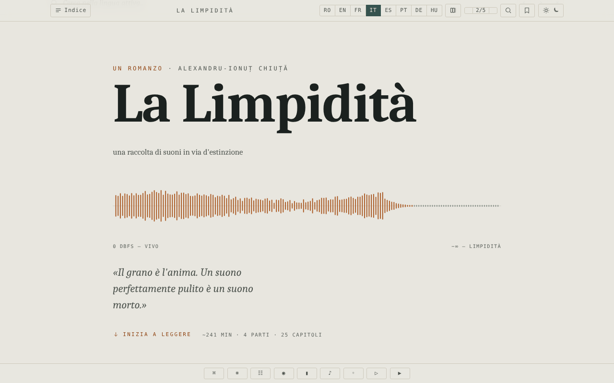

# Limpezimea

[English](README.md) · [Română](README.ro.md) · [Français](README.fr.md) · **Italiano** · [Español](README.es.md) · [Português](README.pt.md) · [Deutsch](README.de.md) · [Magyar](README.hu.md)

**Versione:** 1.2.8 · **Ultimo aggiornamento:** 2026-10-23

Lingue dell'interfaccia: **Română, English, Français, Italiano, Español, Português (PT), Deutsch, Magyar**

Romanzo di fantascienza di Alexandru-Ionuț Chiuță, edizione di lettura in un unico file HTML, in otto lingue (RO · EN · FR · IT · ES · PT · DE · HU).

**Applicazione online:** https://chiuta.github.io/Limpezimea/

## Che cos'è

*Limpezimea* è un romanzo di fantascienza (la descrizione nella pagina: un lago glaciale («tău») dei monti Retezat che divora il suono, l'ordine e il ricordo). Il file `index.html` contiene il testo completo in rumeno e le traduzioni in inglese, francese, italiano, spagnolo, portoghese, tedesco e ungherese, oltre a un apparato critico (cronaca, «Tăul Mut», studio). Secondo la nota del colophon, l'apparato critico è stato scritto con l'assistenza dell'IA (Claude). L'applicazione indica 43.359 parole, circa 241 minuti di lettura.

## Funzioni

- Passaggio tra le 8 lingue (pulsanti RO / EN / FR / IT / ES / PT / DE / HU; il romanzo, la cronaca, «Tăul Mut» e lo studio critico esistono in tutte e 8 le lingue); opzione per mostrare più lingue in parallelo (pulsante «Numero di lingue»).
- Indice per parti e capitoli, navigazione con le frecce, tavolozza dei comandi.
- Temi: scuro, chiaro, seppia, «lago»; dimensione del testo su 5 livelli (A− / A+).
- Ricerca nel testo (elenco dei risultati con contesto, salto all'occorrenza; se il termine non compare nella lingua attiva, pulsanti per passare alle lingue in cui compare), concordanza, glossario degli «intraducibili», minimappa, modalità focus.
- Segnalibri e note personali (con esportazione delle chiose a margine).
- Citazione ritagliabile, texture di «grano» sopra il testo, paesaggio sonoro generativo (Web Audio), scorrimento automatico, «Ascolta» (sintesi vocale del browser).
- Barriera anti-spoiler davanti all'apparato critico («gate»), con sblocco memorizzato.
- Supporto all'accessibilità: link «Vai al testo», regione ARIA live, rispetto della preferenza per la riduzione del movimento.

## Guida all'uso

1. Aprite la pagina; scegliete la lingua con i pulsanti RO … HU (i tasti `1`–`8` scelgono la lingua; `Shift` o `Ctrl`/`Cmd` + clic, oppure una pressione prolungata, attiva/disattiva la visualizzazione in parallelo).
2. Aprite «Indice» per saltare a un capitolo. `←` / `→` oppure `k` / `j` passano al capitolo precedente/successivo; `Home`, `End`, `PageUp`, `PageDown` scorrono.
3. `/` apre la ricerca; `Ctrl+K` / `Cmd+K` apre la tavolozza dei comandi; `Esc` chiude i pannelli.
4. `B` aggiunge/rimuove un segnalibro nella posizione corrente; `N` aggiunge una nota; `F` avvia la modalità focus; `P` cambia il numero di lingue visualizzate.
5. Il pulsante del tema scorre ciclicamente i temi; A− / A+ cambiano la dimensione del testo (un clic su «2/5» la reimposta).
6. I pulsanti della barra inferiore: Comandi, Intraducibili (glossario), Concordanza, Modalità focus, Minimappa, Campo sonoro, Grano, Riproduzione (scorrimento automatico), Ascolta.
7. La posizione di lettura, i segnalibri e le note vengono conservati automaticamente nel browser.

## Privacy e rete

- L'applicazione non effettua chiamate di rete (nessun `fetch`, CDN o risorsa esterna); il colophon afferma «nessun tracciamento, nessun account».
- **Archiviazione locale (`localStorage`, chiavi con il prefisso `limp.`):** lingua, tema, dimensione del testo, posizione di lettura, segnalibri, note, preferenze (focus, minimappa, grano, volume del suono, velocità di scorrimento), stato di sblocco dell'apparato critico.
- «Ascolta» usa la sintesi vocale del browser/del sistema; il comportamento dipende da questi.

## Esecuzione locale / offline

Scaricate `index.html` (circa 2,6 MB) e apritelo nel browser; non richiede internet.

## Licenza

MIT — vedi il file LICENSE

## Audit

2026-10-10: verificato nel browser (0 errori JS, 0 richieste di rete; archiviazione solo `limp.*` in localStorage). Corretto il contrasto delle voci bloccate dell'indice. Il testo letterario e le traduzioni (comprese quelle assistite dall'IA) non sono stati sottoposti a revisione editoriale in questo audit. (La policy CSP è stata aggiunta il 2026-10-11, vedi Cronologia.)

## Cronologia / Changelog

### 1.2.7 — 2026-10-22

fff-kit 1.1.4: aree tattili e testo minimo. Aree tattili/testo corretti nell’app.

### 1.2.6 — 2026-10-22

fff-kit 1.1.2: PBKDF2 a 600.000 iterazioni, protezione anti-clickjacking.

- 1.2.2 — 2026-10-19: l'edizione ungherese è completa: il romanzo (25 capitoli), la cronaca (38 voci), il racconto «Tăul Mut» (22) e lo studio critico (31) sono tradotti in ungherese, quindi tutto il contenuto esiste in tutte e 8 le lingue (prima, in ungherese veniva mostrato il testo inglese). Il testo ungherese è stato scritto con l'assistenza dell'IA, senza un correttore ortografico ungherese, e **richiede una revisione da parte di un madrelingua**; i nomi dei personaggi seguono l'edizione inglese (Ellie, Andrew, Serena, Theodore, Matthew, Mary, Roland, Anna). Il file ora è di circa 3 MB.
- 1.2.1 — 2026-10-19: i pulsanti della dimensione del testo (A− / A+) nella barra degli strumenti erano vuoti e le loro etichette accessibili esistevano solo in RO/EN; ora mostrano A− e A+ e hanno etichette in 8 lingue.

- 1.1.0 — 2026-10-14: Copia di riserva ed etichettatura dei dati (fff-kit).

- 1.0.0 — 2026-10-12: la versione e la data dell'ultimo aggiornamento sono mostrate nell'applicazione (prima versione numerata; nel colophon a piè di pagina, con etichetta nelle 7 lingue).

Giro 7:
- **Corretto (riprodotto prima, verificato dopo):** si sceglieva una lingua (ad es. EN), si premeva il pulsante «Lingue visualizzate» per aggiungere una seconda lingua, e l'interfaccia (messaggi di stato come «Segnalibro aggiunto», `lang` su `<html>`, ricerca nella lingua attiva) passava al rumeno, perché RO è sempre la prima nell'ordine delle colonne. La lingua scelta dal lettore resta ora quella principale anche nella modalità comparativa (l'ordine delle colonne non è cambiato) e viene conservata al ricaricamento. Hash CSP ricalcolati; axe-core = 0 violazioni a 1280 e 360 px.
- Il testo letterario e le traduzioni non sono stati modificati; la dimensione del file (~2,6 MB) è data dal testo in sette lingue, non da risorse incorporate, quindi non si può ridurre senza perdere contenuto.

Giro 6:
- Ricerca: elenco dei risultati con contesto (i primi 100, clic = salto all'occorrenza) e, con 0 risultati nella lingua attiva, pulsanti che passano direttamente alla lingua in cui il termine compare; lo scorrimento tiene conto dell'altezza del pannello. Hash CSP ricalcolati.
- Ricerca nel testo: quando non ci sono risultati nella lingua attiva, la barra mostra ora in quali altre lingue compare il termine (ad es. «0 · RO: 70, DE: 30» per «tău» in francese), invece di un semplice «0».
- Accessibilità: la copertina, la barra di avanzamento e la barra degli strumenti sono ora in punti di riferimento ARIA; axe-core = 0 violazioni (inclusa `region`) a 1280 e 360 px.
- Aggiunta una policy CSP (`<meta>`: script solo tramite hash, `connect-src 'none'`).
- Il testo letterario e le traduzioni non sono stati modificati.

## Autore

Alexio — Alexandru-Ionuț Chiuță. Contatto: alexio@trom.tf

## Riepilogo
Limpezimea («Limpidezza») è un romanzo di fantascienza di Alexandru-Ionuț Chiuță, confezionato come edizione di lettura offline in un unico file HTML, in otto lingue (RO, EN, FR, IT, ES, PT, DE, HU), con un apparato critico in parte scritto con l'assistenza dell'IA (Claude). Funzioni: lingue in parallelo, temi, ricerca, segnalibri e note, paesaggio sonoro, modalità focus. Nessuna richiesta di rete; preferenze salvate in localStorage (`limp.*`). Licenza MIT.

### 1.2.5 — 2026-10-22
- Mobile: tutte le didascalie e i pulsanti dell'interfaccia sotto i 12 px (circa 45 regole: barra degli strumenti, indice, durate dei capitoli, pulsanti della lingua, note, notifica) arrivano ad almeno 12 px; il link «inizia la lettura» ha un'area di tocco più grande. I controlli della dimensione del testo (A−/A+) erano già presenti.

### 1.2.4 — 2026-10-22
- Le etichette rimaste in inglese o bilingui (avanzamento, ripristino, tema, indice, copertina, accesso all’apparato critico, strumenti) sono ora tradotte nelle 8 lingue e si aggiornano al cambio di lingua.

### 1.2.3 — 2026-10-22
- Le etichette di accessibilità (avanzamento della lettura, pausa, pulsanti di chiusura) e il comando «Leggi in rumeno» sono tradotti in tutte le lingue.

