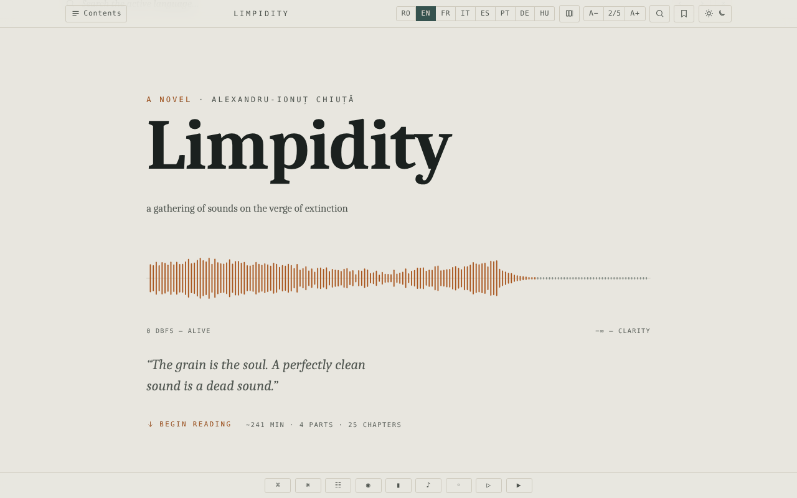

# Limpezimea

**English** · [Română](README.ro.md) · [Français](README.fr.md) · [Italiano](README.it.md) · [Español](README.es.md) · [Português](README.pt.md) · [Deutsch](README.de.md) · [Magyar](README.hu.md)

**Version:** 1.2.0 · **Last updated:** 2026-10-19

Interface languages: **Română, English, Français, Italiano, Español, Português (PT), Deutsch, Magyar**

A science-fiction novel by Alexandru-Ionuț Chiuță, a reading edition in a single HTML file, in seven languages (RO · EN · FR · IT · ES · PT · DE).

**Live app:** https://chiuta.github.io/Limpezimea/

## What it is

*Limpezimea* is a science-fiction novel (the description on the page: a tarn in the Retezat Mountains that eats sound, order and memory). The `index.html` file contains the full text in Romanian and translations into English, French, Italian, Spanish, Portuguese and German, plus a critical apparatus (chronicle, "Tăul Mut", study). According to the note in the colophon, the critical apparatus was written with AI assistance (Claude). The app reports 43,359 words, roughly 241 minutes of reading.

## Features

- Switching between the 8 languages (RO / EN / FR / IT / ES / PT / DE / HU buttons; the novel itself is in the first seven, in Hungarian only the interface is translated and the text is shown in English); an option to display several languages in parallel (the "Number of languages" button).
- Table of contents by parts and chapters, arrow-key navigation, command palette.
- Themes: dark, light, sepia, "tarn"; text size in 5 steps (A− / A+).
- Full-text search (results list with context, jump to the occurrence; if the term does not appear in the active language, buttons to switch to the languages where it does), concordance, glossary of "untranslatables", minimap, focus mode.
- Bookmarks and personal notes (with export of the marginalia).
- Cuttable quotation, "grain" texture over the text, generative soundscape (Web Audio), auto-scroll, "Listen" (the browser's speech synthesis).
- Anti-spoiler gate in front of the critical apparatus ("gate"), with the unlock remembered.
- Accessibility support: "Skip to text" link, ARIA live region, respect for the reduced-motion preference.

## User guide

1. Open the page; choose the language with the RO … HU buttons (keys `1`–`8` choose the language; `Shift` or `Ctrl`/`Cmd` + click, or a long press, toggles parallel display).
2. Open "Contents" to jump to a chapter. `←` / `→` or `k` / `j` go to the previous/next chapter; `Home`, `End`, `PageUp`, `PageDown` scroll.
3. `/` opens search; `Ctrl+K` / `Cmd+K` opens the command palette; `Esc` closes the panels.
4. `B` adds/removes a bookmark at the current position; `N` adds a note; `F` starts focus mode; `P` changes the number of languages displayed.
5. The theme button cycles through the themes; A− / A+ change the text size (clicking "2/5" resets it).
6. The buttons in the bottom bar: Commands, Untranslatables (glossary), Concordance, Focus mode, Minimap, Sound field, Grain, Play (auto-scroll), Listen.
7. The reading position, bookmarks and notes are kept automatically in the browser.

## Privacy and network

- The app makes no network calls (no `fetch`, CDNs or external resources); the colophon states "no tracking, no accounts".
- **Local storage (`localStorage`, keys with the prefix `limp.`):** language, theme, text size, reading position, bookmarks, notes, preferences (focus, minimap, grain, sound volume, scroll speed), the unlock state of the critical apparatus.
- "Listen" uses the browser's/system's speech synthesis; its behaviour depends on these.

## Running locally / offline

Download `index.html` (about 2.6 MB) and open it in a browser; it does not require internet.

## License

MIT — see the LICENSE file

## Audit

2026-10-10: checked in the browser (0 JS errors, 0 network requests; storage only `limp.*` in localStorage). Fixed the contrast of the locked entries in the table of contents. The literary text and the translations (including the AI-assisted ones) were not editorially reviewed in this audit. (The CSP policy was added on 2026-10-11, see History.)

## History / Changelog

- 1.1.0 — 2026-10-14: Backup and data labelling (fff-kit).

- 1.0.0 — 2026-10-12: the version and the date of the last update are shown in the app (first numbered version; in the footer colophon, labelled in the 7 languages).

Round 7:
- **Fixed (reproduced before, verified after):** you chose a language (e.g. EN), pressed the "Languages displayed" button to add a second language, and the interface (status messages such as "Bookmark added", `lang` on `<html>`, search in the active language) switched to Romanian, because RO is always first in the column order. The language chosen by the reader now remains the main one in comparative mode as well (the column order did not change) and is kept on reload. CSP hashes recalculated; axe-core = 0 violations at 1280 and 360 px.
- The literary text and the translations were not modified; the file size (~2.6 MB) comes from the text in seven languages, not from embedded resources, so it cannot be reduced without losing content.

Round 6:
- Search: results list with context (first 100, click = jump to the occurrence) and, at 0 results in the active language, buttons that switch directly to the language where the term appears; scrolling takes the panel height into account. CSP hashes recalculated.
- Text search: when there are no results in the active language, the bar now shows in which other languages the term appears (e.g. "0 · RO: 70, DE: 30" for "tău" in French), instead of a plain "0".
- Accessibility: the cover, the progress bar and the toolbar are now in ARIA landmarks; axe-core = 0 violations (including `region`) at 1280 and 360 px.
- Added a CSP policy (`<meta>`: scripts by hash only, `connect-src 'none'`).
- The literary text and the translations were not modified.

## Author

Alexio — Alexandru-Ionuț Chiuță. Contact: alexio@trom.tf
