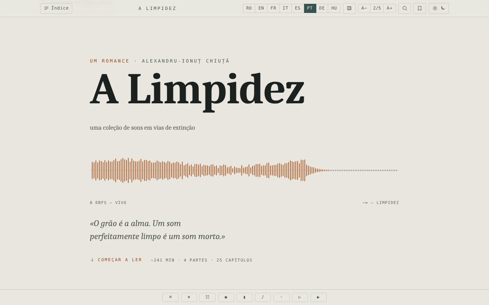

# Limpezimea

[English](README.md) · [Română](README.ro.md) · [Français](README.fr.md) · [Italiano](README.it.md) · [Español](README.es.md) · **Português** · [Deutsch](README.de.md) · [Magyar](README.hu.md)

**Versão:** 1.2.7 · **Última atualização:** 2026-10-22

Idiomas da interface: **Română, English, Français, Italiano, Español, Português (PT), Deutsch, Magyar**

Romance de ficção científica de Alexandru-Ionuț Chiuță, edição de leitura num único ficheiro HTML, em oito idiomas (RO · EN · FR · IT · ES · PT · DE · HU).

**Aplicação online:** https://chiuta.github.io/Limpezimea/

## O que é

*Limpezimea* é um romance de ficção científica (a descrição na página: um lago glaciar («tău») dos montes Retezat que devora o som, a ordem e a memória). O ficheiro `index.html` contém o texto completo em romeno e traduções para inglês, francês, italiano, espanhol, português, alemão e húngaro, além de um aparato crítico (crónica, «Tăul Mut», estudo). Segundo a nota do cólofon, o aparato crítico foi escrito com a assistência de IA (Claude). A aplicação indica 43.359 palavras, aproximadamente 241 minutos de leitura.

## Funcionalidades

- Alternância entre os 8 idiomas (botões RO / EN / FR / IT / ES / PT / DE / HU; o romance, a crónica, «Tăul Mut» e o estudo crítico existem nos 8 idiomas); opção para mostrar vários idiomas em paralelo (botão «Número de idiomas»).
- Índice por partes e capítulos, navegação com setas, paleta de comandos.
- Temas: escuro, claro, sépia, «lago»; tamanho do texto em 5 níveis (A− / A+).
- Pesquisa no texto (lista de resultados com contexto, salto para a ocorrência; se o termo não aparecer no idioma ativo, botões para mudar para os idiomas em que aparece), concordância, glossário de «intraduzíveis», minimapa, modo foco.
- Marcadores e notas pessoais (com exportação das glosas marginais).
- Citação recortável, textura de «grão» sobre o texto, paisagem sonora generativa (Web Audio), deslocamento automático, «Ouvir» (síntese de voz do navegador).
- Barreira antispoiler diante do aparato crítico («gate»), com desbloqueio memorizado.
- Suporte de acessibilidade: ligação «Saltar para o texto», região ARIA live, respeito pela preferência de movimento reduzido.

## Manual de utilização

1. Abra a página; escolha o idioma com os botões RO … HU (as teclas `1`–`8` escolhem o idioma; `Shift` ou `Ctrl`/`Cmd` + clique, ou um toque prolongado, alterna a apresentação em paralelo).
2. Abra «Índice» para saltar para um capítulo. `←` / `→` ou `k` / `j` passam ao capítulo anterior/seguinte; `Home`, `End`, `PageUp`, `PageDown` deslocam o texto.
3. `/` abre a pesquisa; `Ctrl+K` / `Cmd+K` abre a paleta de comandos; `Esc` fecha os painéis.
4. `B` adiciona/remove um marcador na posição atual; `N` adiciona uma nota; `F` ativa o modo foco; `P` altera o número de idiomas apresentados.
5. O botão de tema percorre os temas ciclicamente; A− / A+ alteram o tamanho do texto (um clique em «2/5» repõe-no).
6. Os botões da barra inferior: Comandos, Intraduzíveis (glossário), Concordância, Modo foco, Minimapa, Campo sonoro, Grão, Reprodução (deslocamento automático), Ouvir.
7. A posição de leitura, os marcadores e as notas são conservados automaticamente no navegador.

## Privacidade e rede

- A aplicação não faz chamadas de rede (sem `fetch`, CDN ou recursos externos); o cólofon afirma «sem rastreamento, sem contas».
- **Armazenamento local (`localStorage`, chaves com o prefixo `limp.`):** idioma, tema, tamanho do texto, posição de leitura, marcadores, notas, preferências (foco, minimapa, grão, volume do som, velocidade de deslocamento), estado de desbloqueio do aparato crítico.
- «Ouvir» usa a síntese de voz do navegador/do sistema; o comportamento depende destes.

## Execução local / offline

Descarregue `index.html` (cerca de 2,6 MB) e abra-o no navegador; não requer internet.

## Licença

MIT — ver o ficheiro LICENSE

## Auditoria

2026-10-10: verificado no navegador (0 erros de JS, 0 pedidos de rede; armazenamento apenas `limp.*` em localStorage). Corrigido o contraste das entradas bloqueadas do índice. O texto literário e as traduções (incluindo as assistidas por IA) não foram objeto de revisão editorial nesta auditoria. (A política CSP foi adicionada em 2026-10-11, ver Histórico.)

## Histórico / Changelog

### 1.2.7 — 2026-10-22

fff-kit 1.1.4: áreas de toque e texto mínimo. Áreas de toque/texto corrigidos na aplicação.

### 1.2.6 — 2026-10-22

fff-kit 1.1.2: PBKDF2 com 600.000 iterações, proteção anti-clickjacking.

- 1.2.2 — 2026-10-19: a edição húngara está completa: o romance (25 capítulos), a crónica (38 elementos), o conto «Tăul Mut» (22) e o estudo crítico (31) estão traduzidos em húngaro, pelo que todo o conteúdo existe nas 8 línguas (antes, em húngaro era apresentado o texto inglês). O texto húngaro foi escrito com ajuda de IA, sem corretor ortográfico húngaro, e **precisa de revisão por um falante nativo**; os nomes das personagens seguem a edição inglesa (Ellie, Andrew, Serena, Theodore, Matthew, Mary, Roland, Anna). O ficheiro tem agora cerca de 3 MB.
- 1.2.1 — 2026-10-19: os botões do tamanho do texto (A− / A+) na barra de ferramentas estavam vazios e as suas etiquetas acessíveis só existiam em RO/EN; agora mostram A− e A+ e têm etiquetas em 8 línguas.

- 1.1.0 — 2026-10-14: Cópia de segurança e etiquetagem de dados (fff-kit).

- 1.0.0 — 2026-10-12: a versão e a data da última atualização são apresentadas na aplicação (primeira versão numerada; no cólofon do rodapé, com etiqueta nos 7 idiomas).

Ronda 7:
- **Corrigido (reproduzido antes, verificado depois):** escolhia-se um idioma (p. ex. EN), premia-se o botão «Idiomas apresentados» para acrescentar um segundo idioma, e a interface (mensagens de estado como «Marcador adicionado», `lang` em `<html>`, pesquisa no idioma ativo) passava para romeno, porque o RO é sempre o primeiro na ordem das colunas. O idioma escolhido pelo leitor mantém-se agora como o principal também no modo comparativo (a ordem das colunas não mudou) e é conservado ao recarregar. Hashes CSP recalculados; axe-core = 0 violações a 1280 e 360 px.
- O texto literário e as traduções não foram modificados; o tamanho do ficheiro (~2,6 MB) deve-se ao texto em sete idiomas, não a recursos incorporados, pelo que não pode ser reduzido sem perder conteúdo.

Ronda 6:
- Pesquisa: lista de resultados com contexto (os primeiros 100, clique = salto para a ocorrência) e, com 0 resultados no idioma ativo, botões que mudam diretamente para o idioma em que o termo aparece; o deslocamento tem em conta a altura do painel. Hashes CSP recalculados.
- Pesquisa no texto: quando não há resultados no idioma ativo, a barra mostra agora em que outros idiomas o termo aparece (p. ex. «0 · RO: 70, DE: 30» para «tău» em francês), em vez de um simples «0».
- Acessibilidade: a capa, a barra de progresso e a barra de ferramentas estão agora em pontos de referência ARIA; axe-core = 0 violações (incluindo `region`) a 1280 e 360 px.
- Adicionada uma política CSP (`<meta>`: scripts apenas por hash, `connect-src 'none'`).
- O texto literário e as traduções não foram modificados.

## Autor

Alexio — Alexandru-Ionuț Chiuță. Contacto: alexio@trom.tf

## Resumo
Limpezimea («Limpidez») é um romance de ficção científica de Alexandru-Ionuț Chiuță, apresentado como edição de leitura offline num único ficheiro HTML, em oito idiomas (RO, EN, FR, IT, ES, PT, DE, HU), com um aparato crítico escrito em parte com a assistência de IA (Claude). Funcionalidades: idiomas em paralelo, temas, pesquisa, marcadores e notas, paisagem sonora, modo foco. Sem pedidos de rede; preferências guardadas em localStorage (`limp.*`). Licença MIT.

### 1.2.5 — 2026-10-22
- Telemóvel: todas as legendas e botões da interface abaixo de 12 px (cerca de 45 regras: barra de ferramentas, índice, durações dos capítulos, botões de idioma, notas, notificação) passam a um mínimo de 12 px; a ligação «começar a ler» tem uma área de toque maior. Os controlos de tamanho do texto (A−/A+) já existiam.

### 1.2.4 — 2026-10-22
- As etiquetas que ficavam em inglês ou bilingues (progresso, repor, tema, índice, capa, acesso ao aparato crítico, ferramentas) estão agora traduzidas nas 8 línguas e atualizam-se ao mudar de língua.

### 1.2.3 — 2026-10-22
- As etiquetas de acessibilidade (progresso de leitura, pausa, botões de fecho) e o comando «Ler em romeno» estão traduzidos em todos os idiomas.

