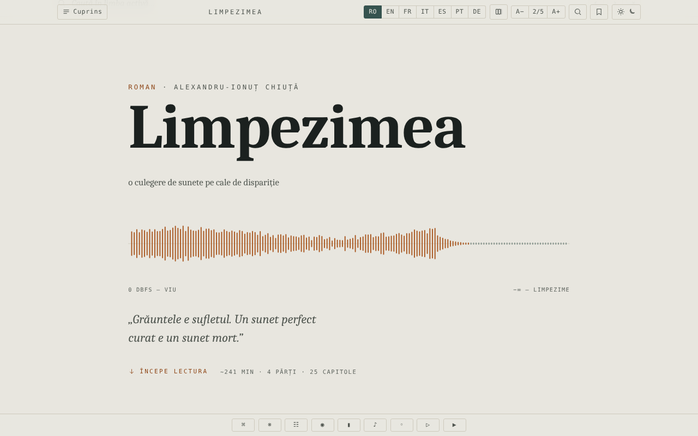

# Limpezimea

[English](README.md) · **Română** · [Français](README.fr.md) · [Italiano](README.it.md) · [Español](README.es.md) · [Português](README.pt.md) · [Deutsch](README.de.md) · [Magyar](README.hu.md)

**Versiune:** 1.1.0 · **Ultima actualizare:** 2026-10-14

Roman SF de Alexandru-Ionuț Chiuță, ediție de lectură într-un singur fișier HTML, în șapte limbi (RO · EN · FR · IT · ES · PT · DE).

**Live:** https://chiuta.github.io/Limpezimea/

## Ce este

*Limpezimea* este un roman SF (descrierea din pagină: un tău din Retezat care mănâncă sunetul, ordinea și amintirea). Fișierul `index.html` conține textul complet în română și traduceri în engleză, franceză, italiană, spaniolă, portugheză și germană, plus un aparat critic (cronică, „Tăul Mut", studiu). Conform notei din colofon, aparatul critic a fost scris cu asistență AI (Claude). Aplicația indică 43.359 de cuvinte, aproximativ 241 de minute de lectură.

## Funcții

- Comutare între cele 7 limbi (butoane RO / EN / FR / IT / ES / PT / DE); opțiune pentru afișarea mai multor limbi în paralel (butonul „Număr de limbi").
- Cuprins pe părți și capitole, navigare cu săgeți, paletă de comenzi.
- Teme: întunecată, luminoasă, sepia, „tău"; mărimea textului pe 5 trepte (A− / A+).
- Căutare în text (listă de rezultate cu context, salt la apariție; dacă termenul nu apare în limba activă, butoane de comutare către limbile unde apare), concordanță, glosar de „intraductibile", minimap, mod focus.
- Semne de carte și note personale (cu export al marginaliilor).
- Citat decupabil, textură de „grăunte" peste text, peisaj sonor generativ (Web Audio), derulare automată, „Ascultă" (sinteză vocală a browserului).
- Poartă anti-spoiler înaintea aparatului critic („gate"), cu deblocare memorată.
- Atașare la accesibilitate: link „Sari la text", regiune ARIA live, respectarea preferinței pentru mișcare redusă.

## Manual de utilizare

1. Deschideți pagina; alegeți limba din butoanele RO … DE (tastele `1`–`7` aleg limba; `Shift` sau `Ctrl`/`Cmd` + clic, sau apăsare lungă, comută afișarea paralelă).
2. Deschideți „Cuprins" pentru a sări la un capitol. `←` / `→` sau `k` / `j` trec la capitolul anterior/următor; `Home`, `End`, `PageUp`, `PageDown` derulează.
3. `/` deschide căutarea; `Ctrl+K` / `Cmd+K` deschide paleta de comenzi; `Esc` închide panourile.
4. `B` adaugă/scoate un semn de carte la poziția curentă; `N` adaugă o notă; `F` pornește modul focus; `P` schimbă numărul de limbi afișate.
5. Butonul de temă ciclează temele; A− / A+ schimbă mărimea textului (clic pe „2/5" o resetează).
6. Butoanele din bara de jos: Comenzi, Intraductibile (glosar), Concordanță, Mod focus, Minimap, Câmp sonor, Grăunte, Redare (derulare automată), Ascultă.
7. Poziția de citire, semnele și notele se păstrează automat în browser.

## Confidențialitate și rețea

- Aplicația nu face apeluri de rețea (fără `fetch`, CDN-uri sau resurse externe); colofonul afirmă „fără urmărire, fără conturi".
- **Stocare locală (`localStorage`, chei cu prefixul `limp.`):** limba, tema, mărimea textului, poziția de citire, semne de carte, note, preferințe (focus, minimap, grăunte, volum sunet, viteză derulare), starea de deblocare a aparatului critic.
- „Ascultă" folosește sinteza vocală a browserului/sistemului; comportamentul depinde de acestea.

## Rulare locală / offline

Descărcați `index.html` (circa 2,6 MB) și deschideți-l în browser; nu necesită internet.

## Licență

MIT — vezi fișierul LICENSE

## Audit

2026-10-10: verificat în browser (0 erori JS, 0 cereri de rețea; stocare doar `limp.*` în localStorage). Corectat contrastul intrărilor blocate din cuprins. Textul literar și traducerile (inclusiv cele asistate de AI) nu au fost revizuite editorial în acest audit. (Politica CSP a fost adăugată la 2026-10-11, vezi Istoric.)

## Istoric / Changelog

- 1.1.0 — 2026-10-14: Copie de rezervă și etichetare date (fff-kit).

- 1.0.0 — 2026-10-12: versiunea și data ultimei actualizări sunt afișate în aplicație (prima versiune numerotată; în colofonul din subsol, cu etichetă în cele 7 limbi).

Runda 7:
- **Corectat (reprodus înainte, verificat după):** alegeai o limbă (ex. EN), apăsai butonul „Limbi afișate” ca să adaugi o a doua limbă, iar interfața (mesajele de stare precum „Semn adăugat”, `lang` pe `<html>`, căutarea în limba activă) trecea pe română, pentru că RO este mereu prima în ordinea coloanelor. Limba aleasă de cititor rămâne acum cea principală și în modul comparativ (ordinea coloanelor nu s-a schimbat) și este păstrată la reîncărcare. Hash-urile CSP recalculate; axe-core = 0 violări la 1280 și 360 px.
- Textul literar și traducerile nu au fost modificate; mărimea fișierului (~2,6 MB) este dată de textul în șapte limbi, nu de resurse încorporate, deci nu se poate reduce fără a pierde conținut.

Runda 6:
- Căutare: listă de rezultate cu context (primele 100, clic = salt la apariție) și, la 0 rezultate în limba activă, butoane care comută direct în limba unde termenul apare; derularea ține cont de înălțimea panoului. Hash-urile CSP recalculate.
- Căutarea în text: când nu există rezultate în limba activă, bara arată acum în ce alte limbi apare termenul (de ex. „0 · RO: 70, DE: 30” pentru „tău” în franceză), în loc de un simplu „0”.
- Accesibilitate: coperta, bara de progres și bara de unelte sunt acum în repere ARIA; axe-core = 0 violări (inclusiv `region`) la 1280 și 360 px.
- Adăugată politică CSP (`<meta>`: scripturi doar pe bază de hash, `connect-src 'none'`).
- Textul literar și traducerile nu au fost modificate.

## Autor

Alexio — Alexandru-Ionuț Chiuță. Contact: alexio@trom.tf

## English summary

Limpezimea ("Limpidity") is a science-fiction novel by Alexandru-Ionuț Chiuță, packaged as a single offline HTML reading edition in seven languages (RO, EN, FR, IT, ES, PT, DE) with a critical apparatus partly written with AI assistance (Claude). Features: parallel languages, themes, search, bookmarks and notes, soundscape, focus mode. No network requests; preferences stored in localStorage (`limp.*`). MIT licence.
